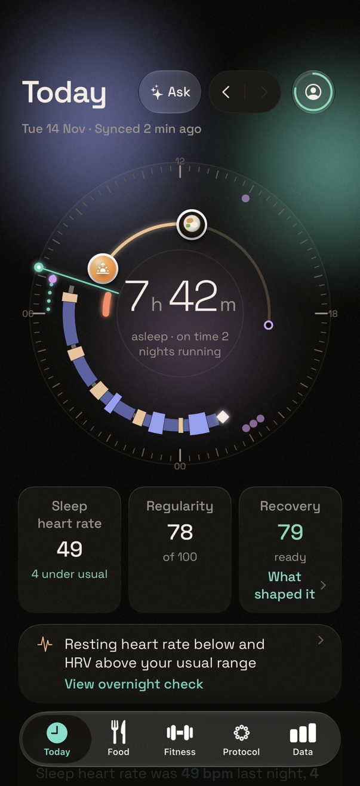
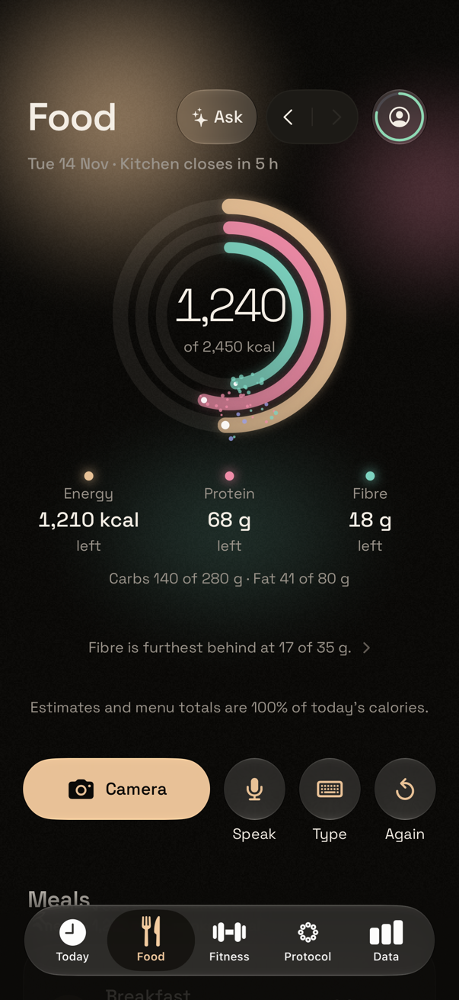
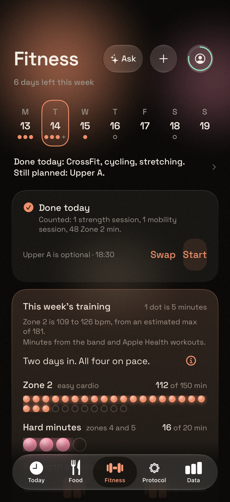
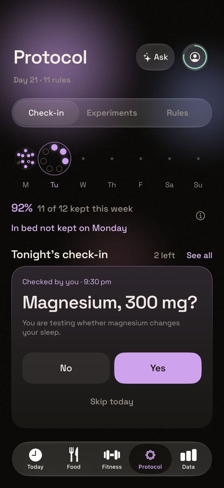
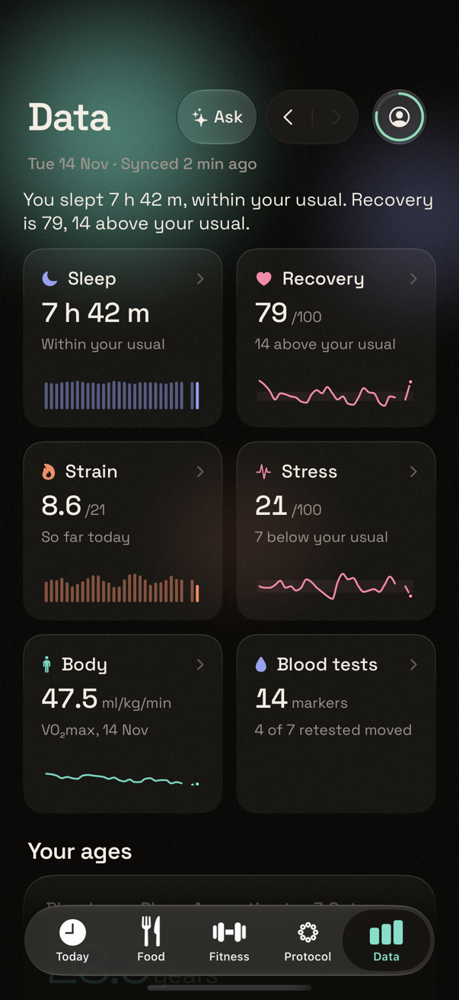
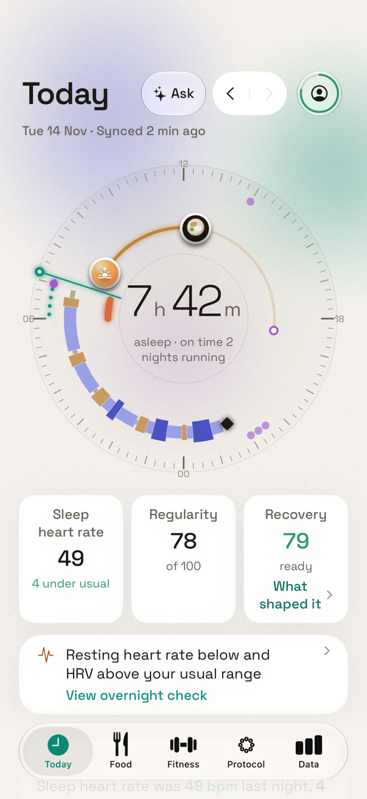
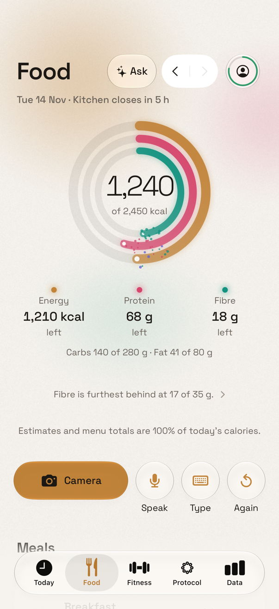
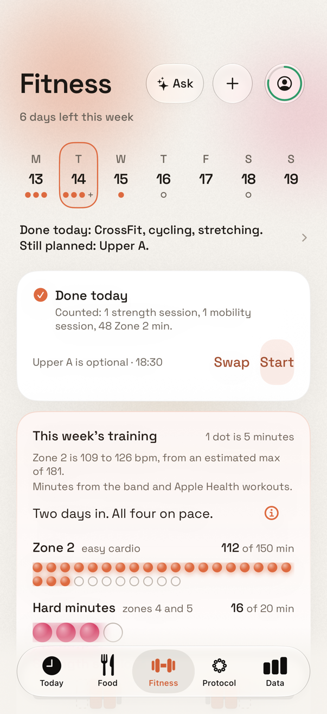
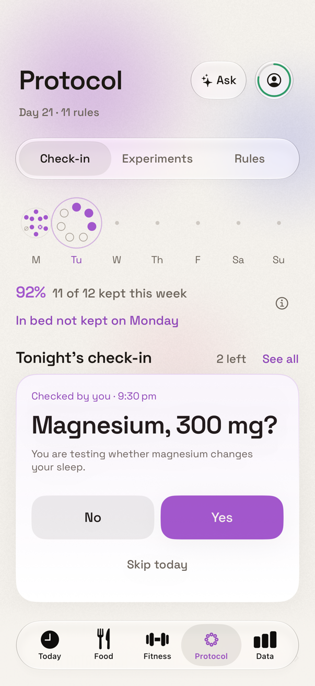
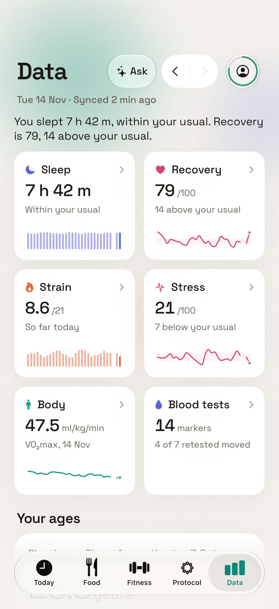

# Loopr Longevity

The open-source longevity app for iPhone. Loopr reads your band over Bluetooth and the Apple Health data you allow, keeps everything on the phone, and shows how your days add up over years: sleep, training, food, the rules you set yourself, and your blood tests.

Loopr is under active development. There is no App Store release and no public beta. TestFlight builds go to a few invited testers. Anyone can build it from source.

## What's in the app

Five tabs.

- **Today.** A day dial of sleep, meals, training and your rules. Tap any part of the dial to open it. After 18:00 the dial counts down to bedtime, and an optional Live Activity shows the evening rules on the lock screen.
- **Food.** Rings for energy, protein and fibre, plants per week, the ultra-processed share of barcoded food, and a morning and evening stack for supplements and medication. Photo logging uses your own AI key. Barcodes go to Open Food Facts.
- **Fitness.** A weekly dose of zone 2, hard, strength and mobility time. A VO₂max gauge against age norms. Capacity tests for grip, dead hang, sit to stand and one-leg balance, plus heart rate recovery from your workouts.
- **Protocol.** Your rules, with versions and a daily check-in. Experiments get a design up front: alternating days, blocks, or before and after, with a washout and a minimum number of nights. A result shows only when the difference is larger than your own night-to-night spread. Protocols are JSON files you can share, and the starter templates live in [`protocols/`](protocols/).
- **Data.** Tiles for sleep, recovery, strain, stress, body and blood tests, each opening its own page. Under them, an age ruler puts blood age (PhenoAge, Levine 2018) and Cardio Age beside your real age. Blood tests are typed in or read from a photo of the report, in English or German, and keep the lab's own reference ranges. Every number has a method page that names its inputs, the paper behind it, and its limits.

Rules on the phone write the morning and evening notes and the weekly review. They run offline and send nothing. Ask, the chat coach, is optional and uses your own OpenAI or Claude API key. Blood tests and supplements stay out of Ask until you switch each one on.

Loopr has no account, no subscription and no Loopr server.

## Try it

There is no public TestFlight. To run Loopr on your own iPhone, follow the steps under [Build](#build) and sign the app with your own Apple developer team. Open an issue for feedback, and leave personal health data out of it.

## Screenshots

These screens use deterministic test data, not personal health records.

<p align="center">
  
  
  
  
  
</p>

<p align="center">
  
  
  
  
  
</p>

## Privacy model

Health records stay in the app's storage on the iPhone. They leave only when you export a file, publish a dashboard, share a protocol, approve an Apple Health write, look up a barcode, or send a question to your AI provider. The release build has no analytics, ads or remote telemetry.

[PRIVACY.md](PRIVACY.md) lists every data type and every network destination in the current code.

## Current status

Don't use Loopr for health decisions. Blood age, Cardio Age and every score are estimates for general wellness, not medical results. Most behavior has automated offline tests. Testing on real bands is ongoing, and so far it covers one WHOOP 4.0 worn daily.

| Hardware | Status |
| --- | --- |
| WHOOP 4.0 | Main target. Used daily on a real band. Firmware-by-firmware test records are not complete. |
| WHOOP 5.0 and MG | Experimental support is included behind an explicit opt-in. Tested-with claims require separate hardware and firmware checks. |
| Apple Health | Loopr reads VO₂max, weight, body composition, blood pressure, blood glucose, daylight and steps, each labelled with the app or device that recorded it. |

Compatibility depends on third-party hardware and firmware that Loopr does not control. A device or firmware update may change or stop Bluetooth communication. Loopr does not guarantee continued compatibility.

## Build

Requirements:

- Xcode 27 or later
- iOS 27 SDK

The app runs on iOS 26 and later. Tests run on iOS 27.0 simulators.

Clone the repository, then open `Loopr/Loopr.xcodeproj` in Xcode and select the `Loopr` scheme. Code signing, Apple Health, App Groups, widgets, and the Watch targets require Apple development settings for your own team.

The main automated checks are:

```sh
xcodebuild build \
  -project Loopr/Loopr.xcodeproj \
  -scheme Loopr \
  -destination 'generic/platform=iOS Simulator' \
  CODE_SIGNING_ALLOWED=NO

xcodebuild test \
  -project Loopr/Loopr.xcodeproj \
  -scheme Loopr \
  -destination 'platform=iOS Simulator,name=iPhone 17 Pro' \
  -only-testing:LooprTests \
  CODE_SIGNING_ALLOWED=NO

cd LooprPackages
xcodebuild test \
  -scheme LooprPackages-Package \
  -destination 'platform=iOS Simulator,name=iPhone 17 Pro' \
  CODE_SIGNING_ALLOWED=NO
```

GitHub Actions compiles the app, runs the iOS unit tests, and scans committed history for secrets on every pull request and push to `main`.

## Repository layout

```text
Loopr/                 iPhone app, app tests, widgets, and shared Apple code
LooprPackages/         Swift packages for Bluetooth, storage, analytics, and features
LooprWatch/            Apple Watch app
LooprWatchWidgets/     Watch complications and widgets
Fixtures/              Synthetic protocol, analytics, and UI test fixtures
protocols/             Protocol templates you can import into the app
Tools/                 Development and parity tools
docs/                  Architecture, protocol, and design notes
scripts/               Local test and verification scripts
```

## Compatibility and independence

Loopr is an independent open-source project. It is not affiliated with, sponsored by, endorsed by, or connected to WHOOP, Inc. "WHOOP" is a trademark of WHOOP, Inc. The name appears here only to identify hardware that Loopr is designed to communicate with.

Loopr does not connect to WHOOP servers and does not ask for WHOOP account credentials.

Loopr is not a copy of the WHOOP app, its services, its algorithms, or its scores. Loopr's calculations use methods implemented in this repository and may produce different results from other products.

Loopr is intended for general fitness and wellness use. It is not a medical device and does not provide medical advice. Its metrics are estimates, not clinical measurements. Do not use Loopr to diagnose, treat, cure, or prevent a disease or health condition.

This repository does not contain the OpenStrap Edge, protocol, or analytics source trees. Do not add WHOOP source code, firmware, logos, or product photos.

## OpenStrap attribution

Loopr was built with reference to MIT-licensed work from [OpenStrap Edge](https://github.com/OpenStrap/edge), [OpenStrap protocol](https://github.com/OpenStrap/protocol), and [OpenStrap analytics](https://github.com/OpenStrap/analytics). Loopr keeps the applicable copyright and permission notice in [NOTICES.md](NOTICES.md) and in the app's license screen.

Removing the upstream source trees from this repository does not erase that provenance. Contributions must keep the notice intact and document the origin of protocol facts and metric methods.

## Support Loopr

Loopr is free and has no company or subscription behind it. Nothing in the app is locked behind a payment, and that won't change. The most useful help is a bug report from a real band.

## Contributing and security

Read [CONTRIBUTING.md](CONTRIBUTING.md) before opening a pull request. It includes strict rules against submitting third-party source, firmware, binaries, artwork, scraped service data, or confidential material.

Do not report a vulnerability in a public issue. Follow [SECURITY.md](SECURITY.md) instead.

## License

Loopr is available under the [MIT License](LICENSE). Third-party notices remain subject to their stated licenses.
