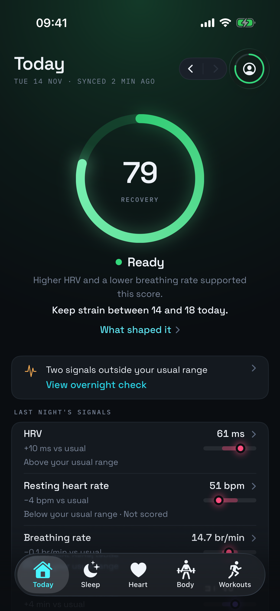
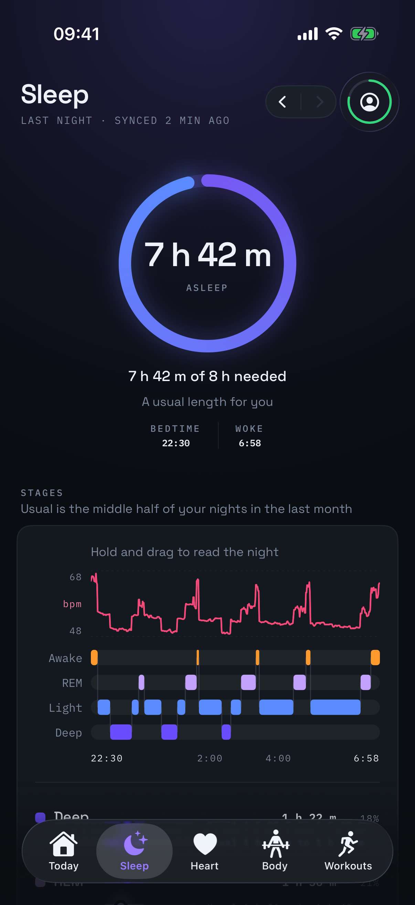
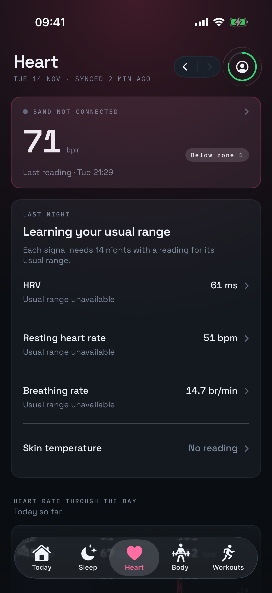
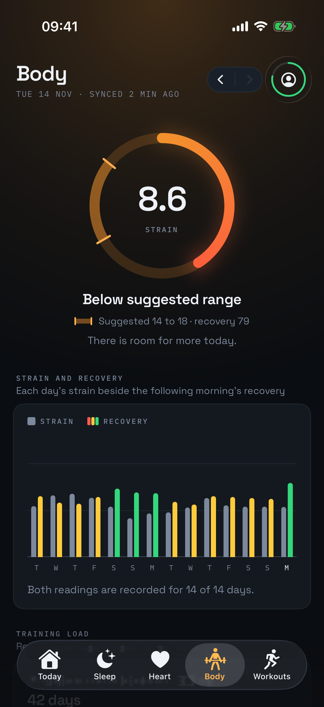
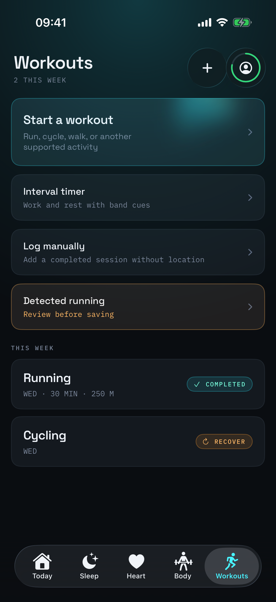

# Loopr

Loopr is an experimental native iOS app that reads data from supported fitness bands over Bluetooth, stores it locally, and calculates fitness and wellness estimates on the iPhone.

Loopr is under active development. There is no App Store release and no public beta. TestFlight builds go to a few invited testers. Anyone can build it from source.

## What Loopr does

- Connects to a supported band over Bluetooth Low Energy.
- Stores sensor records and app data in a local SQLite database.
- Calculates sleep, recovery, activity, heart, stress, and workout estimates on the device.
- Integrates with Apple Health, widgets, Live Activities, App Intents, and a read-only Apple Watch companion.
- Lets the user export and delete local data.

Core operation does not require a Loopr account, Loopr subscription, Loopr backend, or third-party account credentials.

An optional bring-your-own-key AI feature can send data to a provider chosen by the user. It stays off until the user configures it, reviews the request contents, and confirms the request. That provider handles the submitted data under its own terms and privacy policy.

## Try it

There is no public TestFlight. To run Loopr on your own iPhone, follow the steps under [Build](#build) and sign the app with your own Apple developer team. Open an issue for feedback, and leave personal health data out of it.

## Screenshots

These screens use deterministic test data, not personal health records.

<p align="center">
  
  
  
  
  
</p>

## Privacy model

The current release configuration has no Loopr account system, advertising SDK, or remote telemetry provider. Health records remain in the app's local storage unless the user starts an export, authorizes an Apple Health operation, or confirms a request to a configured AI provider.

See [PRIVACY.md](PRIVACY.md) for the data and network boundaries in the current code.

## Current status

Don't use Loopr for health decisions. Most behavior has automated offline tests. Testing on real bands is ongoing, and so far it covers one WHOOP 4.0 worn daily.

| Hardware | Status |
| --- | --- |
| WHOOP 4.0 | Main target. Used daily on a real band. Firmware-by-firmware test records are not complete. |
| WHOOP 5.0 and MG | Experimental support is included behind an explicit opt-in. Tested-with claims require separate hardware and firmware checks. |

Compatibility depends on third-party hardware and firmware that Loopr does not control. A device or firmware update may change or stop Bluetooth communication. Loopr does not guarantee continued compatibility.

## Build

Requirements:

- Xcode 26 or later
- iOS 26 SDK

Clone the repository, then open `Loopr/Loopr.xcodeproj` in Xcode and select the `Loopr` scheme. Code signing, Apple Health, App Groups, widgets, and the Watch targets require Apple development settings for your own team.

The main automated checks are:

```sh
xcodebuild build \
  -project Loopr/Loopr.xcodeproj \
  -scheme Loopr \
  -destination 'generic/platform=iOS Simulator' \
  CODE_SIGNING_ALLOWED=NO

xcodebuild test \
  -project Loopr/Loopr.xcodeproj \
  -scheme Loopr \
  -destination 'platform=iOS Simulator,name=iPhone 17 Pro' \
  -only-testing:LooprTests \
  CODE_SIGNING_ALLOWED=NO

cd LooprPackages
xcodebuild test \
  -scheme LooprPackages-Package \
  -destination 'platform=iOS Simulator,name=iPhone 17 Pro' \
  CODE_SIGNING_ALLOWED=NO
```

GitHub Actions compiles the app, runs the iOS unit tests, and scans committed history for secrets on every pull request and push to `main`.

## Repository layout

```text
Loopr/                 iPhone app, app tests, widgets, and shared Apple code
LooprPackages/         Swift packages for Bluetooth, storage, analytics, and features
LooprWatch/            Apple Watch app
LooprWatchWidgets/     Watch complications and widgets
Fixtures/              Synthetic protocol, analytics, and UI test fixtures
Tools/                 Development and parity tools
docs/                  Architecture, protocol, and design notes
scripts/               Local test and verification scripts
```

## Compatibility and independence

Loopr is an independent open-source project. It is not affiliated with, sponsored by, endorsed by, or connected to WHOOP, Inc. "WHOOP" is a trademark of WHOOP, Inc. The name appears here only to identify hardware that Loopr is designed to communicate with.

Loopr does not connect to WHOOP servers and does not ask for WHOOP account credentials.

Loopr is not a copy of the WHOOP app, its services, its algorithms, or its scores. Loopr's calculations use methods implemented in this repository and may produce different results from other products.

Loopr is intended for general fitness and wellness use. It is not a medical device and does not provide medical advice. Its metrics are estimates, not clinical measurements. Do not use Loopr to diagnose, treat, cure, or prevent a disease or health condition.

This repository does not contain the OpenStrap Edge, protocol, or analytics source trees. Do not add WHOOP source code, firmware, logos, or product photos.

## OpenStrap attribution

Loopr was built with reference to MIT-licensed work from [OpenStrap Edge](https://github.com/OpenStrap/edge), [OpenStrap protocol](https://github.com/OpenStrap/protocol), and [OpenStrap analytics](https://github.com/OpenStrap/analytics). Loopr keeps the applicable copyright and permission notice in [NOTICES.md](NOTICES.md) and in the app's license screen.

Removing the upstream source trees from this repository does not erase that provenance. Contributions must keep the notice intact and document the origin of protocol facts and metric methods.

## Support Loopr

Loopr is free and has no company or subscription behind it. Nothing in the app is locked behind a payment, and that won't change. The most useful help is a bug report from a real band.

## Contributing and security

Read [CONTRIBUTING.md](CONTRIBUTING.md) before opening a pull request. It includes strict rules against submitting third-party source, firmware, binaries, artwork, scraped service data, or confidential material.

Do not report a vulnerability in a public issue. Follow [SECURITY.md](SECURITY.md) instead.

## License

Loopr is available under the [MIT License](LICENSE). Third-party notices remain subject to their stated licenses.
